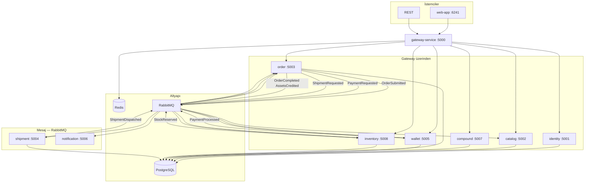

# ElementAPI

ElementAPI, Türkçe bir kimya atlasıdır. Günlük maddelerin hangi elementlerden oluştuğunu gösterir ve kimyayı kısa öğrenme rotalarıyla anlatır.

İçinde 118 element, 214 bileşik, altı öğrenme rotası ve kişisel keşif koleksiyonu var. İlk keşif için hesap gerekmez. Geliştiriciler aynı veriye açık API’den ulaşır. Sanal ticaret ayrı bir demodur; gerçek para veya kargo yoktur.

Yerelde tek komutla açmak için (Docker Desktop gerekir):

```powershell
./deploy/scripts/present-platform.ps1
```

Uygulama http://localhost:6241 adresinde açılır. Her servis kendi konteynerinde çalışır: gateway, identity, catalog, compound, order, wallet `:5005`, inventory `:5008`, shipment, notification, web ve PostgreSQL/Redis/RabbitMQ. Durdurmak için `./deploy/scripts/stop-local.ps1`.

Veritabanı ve broker olmadan yalnız atlası açmak için `./deploy/scripts/present-local.ps1` çalıştır; adres http://127.0.0.1:5080 olur. Bu modda hesap ve ticaret kapalıdır, misafir koleksiyonu çalışır.

Sistem kılavuzu [docs/kilavuz/](docs/kilavuz/README.md) altındadır. Her servisin ne yaptığını, uçlarını, mesajlarını, yapılandırmasını ve dosya dosya kod haritasını anlatır (servis başına bir sayfa, ayrıca altyapı ve arayüz sayfaları). Aynı kılavuz uygulamada `/kilavuz` adresinden okunup aranabilir.

Hangi servisin ne işe yaradığının kısa turu [servis kılavuzunda](docs/SERVIS-KILAVUZU.md). Her klasörün `README.md` dosyası o servisin kullanım notudur. Operatör adımları [deploy/](deploy/README.md), env ayarları [docker/](docker/README.md), belge indeksi [docs/](docs/README.md) altında. Ayrıca: [üç dakikalık sunum](docs/LOCAL-PRESENTATION.md) · [doğrulama](docs/PRODUCT-DELIVERY.md) · [yol haritası](docs/PRODUCT-ROADMAP.md).

Bilimsel katalog (v2) periyodik tabloyu, anlatımlı kayıtları ve laboratuvarı (`/lab`) besler; `view/include/fields`, ETag ve açık CORS destekler. Canlı örnekler uygulamada `/docs`, sözlük `/sozluk` adresindedir. Sözleşme: [Bilimsel katalog](deploy/scientific-catalog.md). Başlamak için: `GET /api/v2/elements/fe`, `GET /api/v2/compounds/h2o`.

Ekranda para birimi KREDI’dir. Piyasa, stok, ödeme ve kargo simülasyondur; gerçek borsa, tahsilat veya fiziksel teslimat yoktur. Kablodaki `*Elx` alan adları bilinçli olarak eski isimleriyle bırakıldı (aşağıdaki sözleşmeye bak).

Yerel geliştirmede arayüz [localhost:5173](http://localhost:5173), API kapısı [localhost:5000](http://localhost:5000) adresindedir. Docker web sürümü `:6241` (`WEB_HOST_PORT`) portunu kullanır.

Lisans MIT: [LICENSE](./LICENSE).

Son iş paketi (2 Ekim 2026, `redesign` dalı): Mineral arayüzü, servislerde okunabilirlik turu, sistem kılavuzu ve test matrisi. Ayrıntı: [recent-work.md](./docs/memory-bank/recent-work.md). Önceki işlerin anlatımı [docs/WHAT-WAS-DONE.md](./docs/WHAT-WAS-DONE.md), agent bellek bankası [docs/memory-bank/](./docs/memory-bank/) altında.

[](#servis-kataloğu)
[](#api-gateway--rota-özeti)

## Hızlı başlangıç

### Tam platform (varsayılan)

Docker Desktop açıkken:

```powershell
# İlk kurulum: docker/.env.example → docker/.env (mevcut .env'i koru)
./deploy/scripts/present-platform.ps1
# veya
docker compose --env-file docker/.env up -d --build
```

| Adres | Ne için? |
|-------|----------|
| [localhost:6241](http://localhost:6241) | Tablo · Bileşikler · Laboratuvar (`/lab`) · Piyasa · Mağaza · API |
| [localhost:5000](http://localhost:5000) | API Gateway |
| [localhost:5000/swagger](http://localhost:5000/swagger) | Catalog OpenAPI (proxy) |

Hazır imajlarla yeniden açmak için `./deploy/scripts/present-platform.ps1 -NoBuild`, durdurmak için `./deploy/scripts/stop-local.ps1`, verileri silmek için `docker compose --env-file docker/.env down -v`. Host’ta 5432 portu doluysa `docker/.env` içinde `POSTGRES_HOST_PORT=5434` ayarla.

### Bağımsız atlas

```powershell
./deploy/scripts/present-local.ps1
```

Adres http://127.0.0.1:5080. Yalnız science imajı çalışır; PostgreSQL, Redis ve RabbitMQ yoktur.

### Ön yüz geliştirme (isteğe bağlı, host)

Vite’ı host’ta çalışan gateway’e karşı açar ve backend imajlarını yeniden derlemez. Node 22+ gerekir.

```powershell
npm --prefix web-app ci
npm --prefix web-app run dev -- --host 127.0.0.1 --port 5173 --strictPort
```

### Testler

| Katman | Komut | Gereken |
|--------|-------|---------|
| .NET birim (Gateway 20 + Services 115) | `./deploy/scripts/test-unit.ps1` | .NET 10 SDK |
| order-service birim | `npm --prefix order-service test` · `npm --prefix order-service run check` | Node 22 |
| Java birim (wallet, inventory) | `mvn -f wallet-service test` · `mvn -f inventory-service test` | Java 21 + Maven |
| Web birim | `npm --prefix web-app test` | Node 22 |
| Entegrasyon (18) | `dotnet test deploy/tests/Element.Services.IntegrationTests --filter "Category=Integration"` | Docker (Testcontainers: Postgres, Redis, RabbitMQ ve gerçek bir wallet-service konteyneri); önce `npm --prefix order-service run build` |
| Tarayıcı, hesaplar kapalı | `npm --prefix web-app run test:e2e` (`web-app/e2e/`) | science-service ve Vite’ı kendisi açar |
| Tarayıcı, hesap akışları | `npm --prefix web-app run test:e2e:auth` (`web-app/e2e-auth/`) | Vite’ı kendisi açar; identity API’si tarayıcıda taklit edilir |
| Tarayıcı, canlı ticaret | `npm --prefix web-app run test:e2e:live` (`web-app/e2e-live/`) | Tam Docker platformu `:6241` (`WEB_BASE`) |
| Canlı API | `node deploy/scripts/test-scientific-api.mjs` · `node deploy/scripts/test-e2e.mjs` · `./deploy/scripts/test-saga.ps1` · `./deploy/scripts/test-smoke.ps1` · `node deploy/scripts/test-platform.mjs` | Çalışan yerel servisler |

Playwright ilk kullanımdan önce `web-app` içinde bir kez `npx playwright install chromium` ister.

Hepsini tek komutla çalıştırmak için `./deploy/scripts/test-all.ps1` (kısayol `./scripts/test.ps1`). Bu script her zaman web lint/test/build, order-service build/check/test, .NET derleme ve birim testleri ile npm audit çalıştırır. İsteğe bağlı anahtarlar: `-Browser` (`test:e2e` + `test:e2e:auth`), `-Integration`, `-Live` (canlı API script’leri + `test:e2e:live`; web adresi `-WebBase`, varsayılan `http://localhost:6241`), `-Recovery` (PostgreSQL yedek/geri yükleme provası). Java birim testleri bu script’te yok; Jenkins onları yol eşleşmesiyle koşar ([CI-JENKINS.md](docs/CI-JENKINS.md)).

Canlı script’lerin yaptıkları: `test-saga.ps1` gerçek PostgreSQL’de geçici bir şemada çift ödeme, iade, zaman aşımı ve geç mesajları sınar, sonunda şemayı kaldırır. `test-e2e.mjs` ve `test-smoke.ps1` ayrı deneme hesapları açıp sipariş ve satış akışını dener. `test-platform.mjs` sağlık uçlarını, derlenmiş web sayfalarını ve ticker fiyatını doğrular. Hesap yaşam döngüsü ve yedek provasının kaydı: [LOCAL-VERIFICATION.md](docs/LOCAL-VERIFICATION.md).

Kök kısayollar: `./scripts/present.ps1` · `./scripts/up.ps1` · `./scripts/test.ps1` · `./scripts/lint.ps1`. Ayrıntı: [CONTRIBUTING.md](./CONTRIBUTING.md).

### Bilimsel veri ve alışveriş sözleşmesi

- Elementlerin kütle, yoğunluk, sıcaklık, elektron dizilimi ve elektronegatiflik verisi [PubChem periyodik tablosundan](https://pubchem.ncbi.nlm.nih.gov/periodic-table/) alınan sürümlenmiş dosyadan gelir. Yanıtlarda `sourceUrl`, `retrievedAt` ve `units` bulunur; kaynaktaki bilinmeyen değerler `null` kalır. Atom numarası 119 gibi varsayımsal kayıtlar yayımlanmaz.
- 214 bileşiğin hepsinde formül, molar kütle, PubChem CID ve 2D yapı görseli bulunur. 51 kayıt tam PubChem anlık görüntüsüdür; kalan 163 kısa eğitim kaydıdır (fiziksel/GHS alanları boş, `null`). Allotrop ve preparatlar saf bir bileşik kaydı gibi sunulmaz. Mağaza SKU kataloğu ayrıdır.
- Atlas katmanı (Türkçe anlatım, görseller, Wikipedia/PubChem linkleri) `node deploy/scripts/refresh-atlas.mjs` ile yeniden uygulanır; bilimsel yenilemeden sonra otomatik çalışır. Medya indirme: `node deploy/scripts/refresh-atlas.mjs --fetch`.
- Veriyi bilinçli olarak yenilemek için `node deploy/scripts/refresh-element-properties.mjs` ve `node deploy/scripts/refresh-compound-properties.mjs --force` kullanılır. API çalışırken dış kaynağa bağımlı değildir.
- Siparişe gram cinsinden sayısal `quantity` gönderilir (en fazla dört ondalık). `Idempotency-Key` olarak aynı UUID ile tekrar gönderilen aynı sipariş yalnız bir kez ücretlendirilir; farklı içerik `409` döner.
- Kasadaki her ürün `symbol + compoundSlug` ile ayrılır. NaCl, saf Na gibi satılamaz. Satışta aynı `compoundSlug` gönderilir; alış ve satış fiyatı sunucuda hesaplanır. Başarısız veya zaman aşımına uğramış siparişte ayrılan stok serbest bırakılır, tahsil edilmiş Kredi bir kez iade edilir.
- Para birimi kodu `KREDI`, fiyat kaynağı `simulation`dır. Alan adları kırıcı bir değişiklik olmasın diye kasıtlı olarak yeniden adlandırılmadı: wire/API alan adları ve reason kodları geçmişten kalan `*Elx` biçiminde kalır, değerler Kredi’dir. Korunan isimler: `balanceElx`, `avgCostElx`, `proceedsElx`, `requiredElx`, reason `INSUFFICIENT_ELX`, DB kolonları `balance_elx` / `avg_cost_elx` / `elx`. Yanıtta `currency: "KREDI"` ile doğrulayın. Bu konuda tek kaynak bu maddedir; servis README’leri buraya işaret eder.
- Cüzdan ve siparişler ortak yanıt önbelleğine girmez. Sipariş durumu herkese açık kanaldan gitmez; istemci kendi siparişlerini kimlik doğrulayarak sorgular. İç servis çağrıları ayrıca paylaşılan servis anahtarı ister.

### Public yapılandırma taslağı

Web ve gateway yalnız loopback portlarına bağlanır; HTTPS reverse proxy ayrıca gerekir. Geliştirme sırları değiştirilmeden servisler Production modunda açılmaz:

```bash
cp docker/.env.example docker/.env
docker compose --env-file docker/.env -f docker-compose.yml -f docker-compose.public.yml up -d --build
```

Kullanıcı akışı: kayıt ol, `GET /api/v1/me/wallet` ile hoş geldin grant’ini al (`WALLET_WELCOME_GRANT`; yerel 10.000 / public 1.000), mağazadan Au al (ask), kasada gör, masadan sat (bid).

## Mimari



### Sipariş saga (event-driven)

```
POST /api/v1/orders          →  Submitted + OrderSubmittedEvent
  → inventory (stok ayır)    →  StockReservedEvent
  → order                    →  PaymentRequestedEvent
  → wallet (KREDI düş)       →  PaymentProcessedEvent  (veya PaymentFailed)
  → order                    →  Shipping + ShipmentRequestedEvent
  → shipment                 →  ShipmentDispatchedEvent
  → order Completed
       → AssetsCreditedEvent (holdings) + OrderCompletedEvent (stok kalıcı + fiyat nudge)
```

İptal veya zaman aşımında `OrderStockReleaseEvent` ve `PaymentRefundRequestedEvent` yayınlanır. Ayrı bir payment JVM yok; ödeme tavanı 50.000 KREDI.

## Servis kataloğu

Her servisin README’si o servisin nasıl açılacağını, [kılavuz](docs/kilavuz/README.md) sayfası ise içini (uçlar, mesajlar, kod haritası) anlatır. Hangi servisin ne işe yaradığının kısa turu: [servis kılavuzu](docs/SERVIS-KILAVUZU.md).

| Servis | Port | Stack | Rol | Belgeler |
|--------|------|-------|-----|----------|
| science-service | 5080 | .NET 10 | Atlas, tek kutu (DB yok) | [README](./science-service/README.md) · [kılavuz](docs/kilavuz/science.md) |
| gateway-service | 5000 | .NET 10 YARP | Kapı, API anahtarı, hız sınırı | [README](./gateway-service/README.md) · [kılavuz](docs/kilavuz/gateway.md) |
| identity-service | 5001 | .NET 10 | Hesap, JWT, anahtar, öğrenme | [README](./identity-service/README.md) · [kılavuz](docs/kilavuz/identity.md) |
| catalog-service | 5002 | .NET 10 | 118 element: bilim + sanal fiyat | [README](./catalog-service/README.md) · [kılavuz](docs/kilavuz/catalog.md) |
| compound-service | 5007 | .NET 10 | Eğitim bileşikleri (mağaza SKU’larından ayrı) | [README](./compound-service/README.md) · [kılavuz](docs/kilavuz/compound.md) |
| order-service | 5003 | Node.js 22 | Sipariş saga orkestrasyonu | [README](./order-service/README.md) · [kılavuz](docs/kilavuz/order.md) |
| wallet-service | 5005 | Java 21 Spring | KREDI cüzdan, ledger, holdings, desk sell | [README](./wallet-service/README.md) · [kılavuz](docs/kilavuz/wallet.md) |
| inventory-service | 5008 | Java 21 Spring | Stok ayırma / serbest bırakma / düşüm | [README](./inventory-service/README.md) · [kılavuz](docs/kilavuz/inventory.md) |
| shipment-service | 5004 | .NET 10 | Sahte kargo + takip | [README](./shipment-service/README.md) · [kılavuz](docs/kilavuz/shipment.md) |
| notification-service | 5006 | .NET 10 | Sipariş webhook’u | [README](./notification-service/README.md) · [kılavuz](docs/kilavuz/notification.md) |
| web-app | 6241 / 5173 | React + Vite | Tablo · laboratuvar · mağaza | [README](./web-app/README.md) · [kılavuz](docs/kilavuz/web-app.md) |
| shared-lib | — | .NET 10 lib | Ortak olay ve sağlık uçları | [README](./shared-lib/README.md) · [kılavuz](docs/kilavuz/shared-lib.md) |

Compose, script’ler, Caddy, Jenkins ve veri yenileme: [altyapı kılavuzu](docs/kilavuz/altyapi.md).

## API Gateway — rota özeti

Gateway üzerinden (`localhost:5000`) erişilen rotalar:

| Rota | Hedef | Auth |
|------|-------|------|
| `GET /api/v1` | Catalog discovery | — |
| `GET /api/v2/elements/**` | Catalog (bilimsel) | Public (`fields` / ETag / CORS) |
| `GET /api/v2/compounds/**` | Compound (bilimsel) | Public |
| `GET /api/v1/elements/**` | Catalog | History için API key; ticker public |
| `GET /api/v1/compounds/**` | Compound | Public |
| `GET /api/v1/market/**` | Catalog | Public (movers, board) |
| `GET /api/v1/stock/**` | Inventory | Public |
| `POST /api/v1/auth/register\|login` | Identity | — |
| `* /api/v1/api-keys/**` | Identity | JWT |
| `* /api/v1/webhooks/**` | Identity | JWT |
| `* /api/v1/me/**`, `/desk/**` | Wallet | API key |
| `* /api/v1/orders/**` | Order | API key (`X-API-Key`) |
| `* /api/v1/shipments/track/**` | Shipment | API key |

Gateway dışında kalan iç uçlar: shipment saga worker’ı ve identity `POST /api/v1/internal/api-keys/validate`. Tam rota tablosu ve hata kodları: [gateway kılavuzu](docs/kilavuz/gateway.md#uç-noktalar).

Servis keşfi: `GET http://localhost:5000/info`. RabbitMQ yönetim arayüzü `localhost:15672` adresinde; kullanıcı ve şifre `docker/.env` içinde.

## Standart operasyon endpoint'leri

Tüm backend servisler aynı operasyon uçlarını sunar:

| Endpoint | Açıklama |
|----------|----------|
| `GET /info` | Servis adı, sürüm, ortam, link haritası |
| `GET /health` | Readiness (bağımlılıklar dahil) |
| `GET /health/live` | Liveness (process ayakta mı) |
| `GET /health/ready` | Readiness (DB, Redis, RabbitMQ…) |

Wallet ve inventory (Spring) ayrıca `/actuator/health` sunar; Docker healthcheck `/health` kullanır.

Prometheus `/metrics`, HealthChecks UI (`/health-ui`) ve ELK/Grafana yığını bilinçli olarak kaldırıldı; bu uçlar 404 döner.

## Veritabanları

Tek bir Postgres instance’ında her servisin ayrı veritabanı var:

| DB | Servis |
|----|--------|
| `element_identity_db` | identity-service |
| `element_market_db` | catalog-service |
| `element_compound_db` | compound-service |
| `element_order_db` | order-service |
| `element_wallet_db` | wallet-service |
| `element_inventory_db` | inventory-service |
| `element_shipment_db` | shipment-service |

## Geliştirme

```bash
./deploy/scripts/build-all.ps1
./deploy/scripts/test-unit.ps1
./deploy/scripts/test-smoke.ps1   # Yerel servisler ayaktayken smoke test
```

Günlük arayüz işi için Vite’ı host’ta, çalışan kapıya karşı aç (`web-app` README). Tek bir servis üzerinde çalışırken o klasörün README’sine bak. Her CSS değişikliğinde platformu `docker compose up --build` ile yeniden derleme. Ayrıntı: [servis kılavuzu](docs/SERVIS-KILAVUZU.md).

## Public / subdomain

Kâğıt kredi para değildir. Piyasa yapıcı evin kendisidir; emir defteri ve eşleştirme yok. Lisans MIT: [LICENSE](./LICENSE).

Public overlay, Caddy’yi `:80`/`:443` üzerinde açar; DB ve servis portları kapalı kalır. Alan adı https://elements-api.ahmetfuzunkaya.com. Adım adım kurulum [docs/PUBLIC-HOST.md](docs/PUBLIC-HOST.md) dosyasında (`docker/.env.public.example` + `deploy/Caddyfile.elements-api`).

```bash
cp docker/.env.public.example docker/.env   # sırları değiştir (≥32, ChangeMe yok)
docker compose --env-file docker/.env -f docker-compose.yml -f docker-compose.public.yml up -d --build
# veya: ./deploy/scripts/present-public.ps1
```

TLS, Caddy konteynerinde (`deploy/Caddyfile.elements-api`) yapılır. DNS A/AAAA kayıtları sunucuyu göstermeli.

| Env | Ne işe yarar |
|-----|----------------|
| `VITE_PUBLIC_SITE_URL` | Canonical, Open Graph, sitemap. Build arg; değişince web-app yeniden derlenmeli. |
| `VITE_API_BASE_URL` | Tarayıcının çağırdığı public gateway (`…/api/v1`). Değişince yeniden derle. |
| `PUBLIC_WEB_ORIGIN` | Gateway CORS. Çalışma anında okunur. |
| `PUBLIC_API_BASE` | Catalog HATEOAS (`X-Forwarded-Host` gelmezse). Gateway origin’i, `/api/v1` olmadan. |
| `PUBLIC_SITE_URL` | Konteyner açılırken `robots.txt` / `sitemap.xml` içindeki `__SITE_URL__` yer tutucusunu doldurur (compose bunu `VITE_PUBLIC_SITE_URL` ile set eder). |

JWT `localStorage`’da durur ve origin’e bağlıdır. Cookie auth yok.

Tek host kullanımı (bu repo böyle çalışır: `https://elements-api.ahmetfuzunkaya.com` adresinde UI `/`, API `/api` ve `/swagger` altında; ayrıntı [PUBLIC-HOST.md](docs/PUBLIC-HOST.md)):

```
PUBLIC_WEB_ORIGIN=https://elements-api.ahmetfuzunkaya.com
VITE_PUBLIC_SITE_URL=https://elements-api.ahmetfuzunkaya.com
VITE_API_BASE_URL=/api/v1
PUBLIC_API_BASE=https://elements-api.ahmetfuzunkaya.com
```

İki subdomain kullanımı (`app` + `api`):

```
PUBLIC_WEB_ORIGIN=https://app.example.com
VITE_PUBLIC_SITE_URL=https://app.example.com
VITE_API_BASE_URL=https://api.example.com/api/v1
PUBLIC_API_BASE=https://api.example.com
```

Reverse proxy `X-Forwarded-Host` / `X-Forwarded-Proto` başlıklarını geçirmeli; geçirmezse linkleri `PUBLIC_API_BASE` düzeltir. Gateway hız sınırı, peer loopback olduğunda ilk `X-Forwarded-For` hop’unu kullanır.

SPA’da `index.html` varsayılan meta etiketlerini taşır; rota başlıklarını istemcide `Seo` bileşeni yazar. `robots.txt` ve `sitemap.xml` (`/lab`, bileşikler, 118 `/element/{symbol}`) nginx’ten statik olarak sunulur.

## Eksikler ve yapmak istediklerimiz

Durum 2 Ekim 2026 itibarıyla. Atlas, laboratuvar ve bilimsel API yerelde gösterime hazır. İnternete açmak operatör işi ve birkaç bilinçli karar gerektirir. Aşağıdaki eksiklerin çoğu ürün hatası sayılmaz; bilinçli sınır ya da sonraya bırakılmış iştir.

### Zaten yeterince iyi (göstermek / beta)

- 118 element, 214 bileşik, sürükle-bırak `/lab` (hit/almost/impossible), Formülü kur / Dedektif, 6 öğrenme rotası, misafir koleksiyonu.
- Bilimsel v2 (`fields` / ETag / CORS), `/docs` playground, bağımsız atlas `:5080`.
- Tam Docker ve public overlay (Caddy, dev/test/prod env dosyaları); sağlık uçları `/health` / `/info`.
- Sipariş saga’sı event-driven (inventory, ardından wallet `PaymentRequested`, ardından shipment); KREDI simülasyon, gerçek para yok.
- Mineral arayüzü (yalnız açık tema, tek kuprit vurgu); ticaret demosu menüde geri planda.
- Sistem kılavuzu (`docs/kilavuz/`, uygulamada `/kilavuz`) ve yukarıdaki test matrisi.

### Şimdi yayın için (engeller / kararlar)

Bunları public’e çıkmadan önce netleştir. Ortadaki sütun repo tarafında hazırlananları (24 Eylül 2026), son sütun senin host’ta yapman gerekenleri gösterir.

| Engel | Repo’da | Hâlâ sende |
|-------|---------|------------|
| DNS + TLS | Checklist ve `present-public.ps1 -Server` ile `CADDY_SITE`/80/443 doğrulaması ([PUBLIC-HOST.md](docs/PUBLIC-HOST.md)) | A/AAAA kaydını sunucuya yönlendir; `CADDY_SITE=elements-api…`; gerçek `.env.public.prod` |
| Sırlar | Örneklerde `replace-with-…` ≥32, `ChangeMe` yok; `openssl rand -hex 32` notu; `-Server` placeholder’ı reddeder | Sunucuya gerçek JWT / INTERNAL_API_KEY / DB / Rabbit değerlerini yaz |
| Proxy IP | Gateway `TRUSTED_PROXY_CIDRS` okur; public örnek ve compose’da Docker CIDR varsayılanı | Özel overlay’de CIDR’ları gözden geçir |
| E-posta | E-postasız beta: SMTP boşsa kurtarma kapalı; UI ve `capabilities` bunu doğru bildirir; Resend SMTP iskeleti dokümanda | İstersen sonra Resend API key + doğrulanmış alan |
| Ticaret demosu | `/market` `/shop` `/account` `/demo` banner’ı ve sayfa dili: KREDI sanal, gerçek para yok | — |
| Abuse / hız | Gateway: kayıt 5/dk, auth POST 15/dk, genel 60/10sn; public `WALLET_WELCOME_GRANT=1000`; login kilidi 5 hatada 15 dk; Caddy headers + body 1MB; Turnstile (`CAPTCHA_SECRET_KEY` + `VITE_CAPTCHA_SITE_KEY`, boş = kapalı) | DNS sonrası istersen Cloudflare orange-cloud (gerçek WAF) |
| Gözlem yığını yok | Kasıtlı 404 | — |
| Fotoğraf boşlukları | 75/118; bilinçli null | Lisansı uygun olmayan görselle doldurma |
| Playwright | `e2e/` (hesaplar kapalı), `e2e-auth/` (taklit identity), `e2e-live/` (tam platformda ticaret yolculuğu); Jenkins `test:e2e` koşar | `e2e-live`’ı yayın öncesi platforma karşı koşmak |
| Kılavuzdaki yerel sırlar | `/kilavuz` altyapı sayfası compose’un yerel varsayılan sırlarını gösterir (Postgres/RabbitMQ şifresi, `INTERNAL_API_KEY`, JWT yer tutucusu); public overlay JWT ve iç anahtarı zorunlu tutar, `-Server` yer tutucuyu reddeder | Karar: bu satırlar public derlemede görünsün mü ([open-risks.md](docs/memory-bank/open-risks.md)) |
| Learning Progress | Identity + tarayıcı | Ayrı servis (sonra) |
| CI | Jenkins Multibranch + path matrix ([CI-JENKINS.md](docs/CI-JENKINS.md)) | Host’ta Multibranch job + status check |

Kısa operatör adımları (DNS hazır olunca):

```bash
# 1) docker/.env.public.prod düzenle (CADDY_SITE, 80/443, https origins, openssl sırları)
# 2) ./deploy/scripts/present-public.ps1 -Server
# 3) curl -sI https://elements-api.ahmetfuzunkaya.com/
```

### Sonra (yol haritası, yayın blocker değil)

- Öğrenci/öğretmen pilotu; içerik ve editöryel gözden geçirme.
- Playwright canlı auth/sipariş testlerini (`test:e2e:live`) staging’de düzenli koşmak.
- Resend (SMTP veya API) ve doğrulanmış alan adı; beta e-postasız gidebilir.
- Bileşik eğitim kayıtlarında fiziksel/GHS alanlarını genişletmek (51 tam anlık görüntü; 163 kısa kayıt).
- İstersen Cloudflare orange-cloud (DNS sonrası). Stock Caddy’de `rate_limit` eklentisi yok; Turnstile ve gateway hız sınırı yeterli.
- İstersen hafif ürün ölçümü (keşif/görev); büyük bir observability yığını hedeflenmiyor ([ADR 0001](docs/adr/0001-observability-metrics.md)).
- Learning Progress’i identity’den ayırmak (ancak ihtiyaç kanıtlanınca).
- Auth: httpOnly cookie / refresh ([AUTH-COOKIE-BACKLOG.md](docs/runbooks/AUTH-COOKIE-BACKLOG.md), hedef 2026-12-31).

### Kutulara göre (tek satır, “sonra”)

| Alan | İyi olan | Sonra bakılabilir |
|------|----------|-------------------|
| catalog | v2 element + simülasyon fiyat; Redis yok | Boş özellik bölümlerini UI’da daha net saklamak |
| compound | 214 eğitim kaydı (mağaza SKU’sundan ayrı); hepsinde yapı görseli | Kısa kayıtlara PubChem fiziksel/GHS |
| gateway | YARP, anahtar, kayıt 5/dk · auth 15/dk · 60/10sn, `TRUSTED_PROXY_CIDRS` | Caddy xcaddy `rate_limit` (bilinçli yok) |
| identity | JWT, anahtar, öğrenme PUT, hesap silme; e-postasız beta; 5 hatada 15 dk kilit; Turnstile (`CAPTCHA_SECRET_KEY`) | Resend |
| wallet | Java ledger + `PaymentRequested`; `WALLET_WELCOME_GRANT` (yerel 10k / public 1k) | Operasyon/izleme yüzeyi (isteğe) |
| inventory | Reserve/release/fulfill | Aynı |
| order | Saga orkestrasyonu, 50k KREDI tavan | `*Elx` isimleri bilinçli; rename yok |
| shipment | Sahte takip | Gerçek kargo yok ve istenmiyor |
| notification | `order.updated` webhook, SSRF koruması | Kalıcı retry / teslimat geçmişi (ürünleşirse) |
| science | Tek kutu atlas, DB yok | Medya/JSON senkron disiplini |
| web-app | Mineral arayüz, `/kilavuz`, üç Playwright paketi; demo dili net | Demo rotalarını daha da geri plana almak |
| deploy / docker | present-*, `-Server` guard, public matrix | Sunucu runbook’unu pratikte tekrar denemek |
| shared-lib | Ortak olay / health | Büyütme yok; ince tut |

Açık risk listesi (kısa, agent için): [open-risks.md](docs/memory-bank/open-risks.md).

## Dizin yapısı

```
element-api/
├── science-service/     gateway-service/     identity-service/
├── catalog-service/     compound-service/    order-service/
├── wallet-service/      inventory-service/   shipment-service/
├── notification-service/
├── web-app/             shared-lib/
├── deploy/              docker/
├── docker-compose.yml   docker-compose.science.yml
├── docs/kilavuz/        (sistem kılavuzu; uygulamada /kilavuz)
├── docs/SERVIS-KILAVUZU.md
└── README.md
```

Her servis klasöründeki `README.md` kullanım notudur; iç ayrıntılar `docs/kilavuz/` altındadır.

## Ön yüz ve ürün senaryoları

Ön yüz "Mineral" tasarım sistemiyle kuruldu: yalnız açık tema, tek vurgu rengi kuprit, kırık beyaz zemin ve beyaz kartlar, yazı tipleri Geist (başlık ve gövde) ve Geist Mono (sembol, formül, kod). Jetonlar tek dosyada (`web-app/src/styles.css`), bileşenler `web-app/src/components/ui/` altında; Radix tabanlı, Tailwind 4. Bileşen vitrini geliştirme sunucusunda `/_ui` adresindedir (üretim derlemesine girmez). Kurallar: [tasarım sistemi](docs/memory-bank/design-system.md). Devam çalışmaları için: [ürün senaryoları](docs/PRODUCT-SCENARIOS.md) · [memory bank](docs/memory-bank/README.md).
